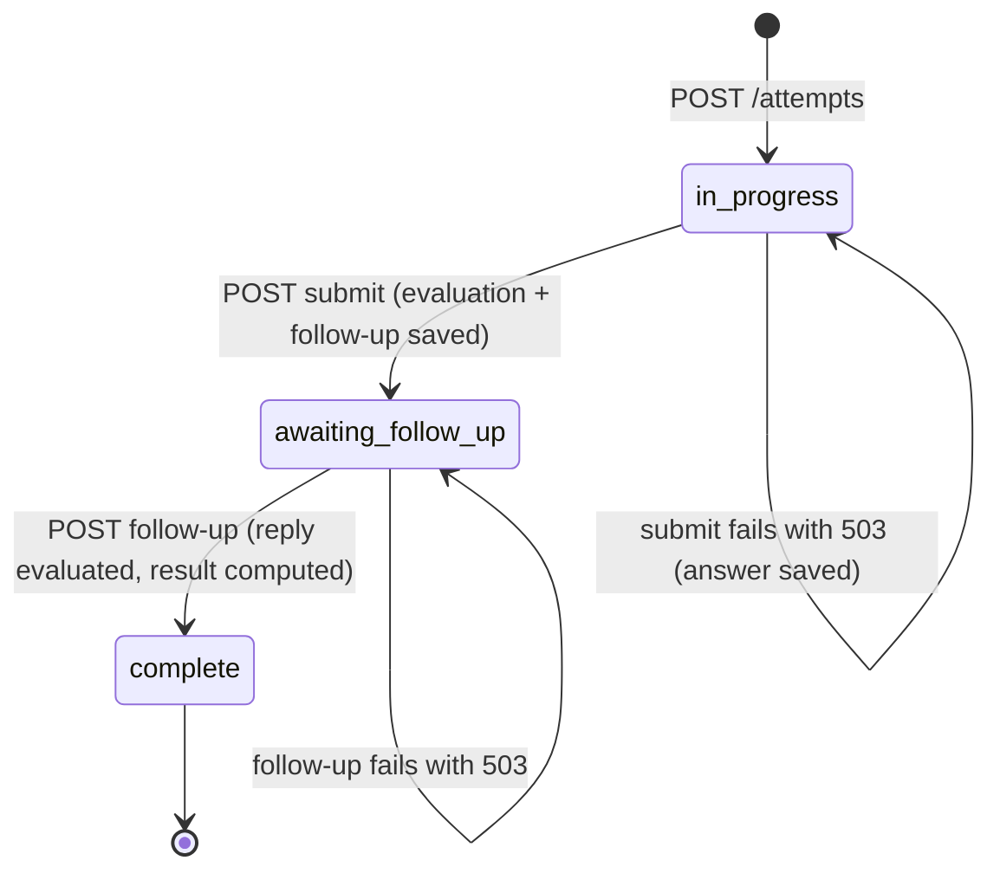
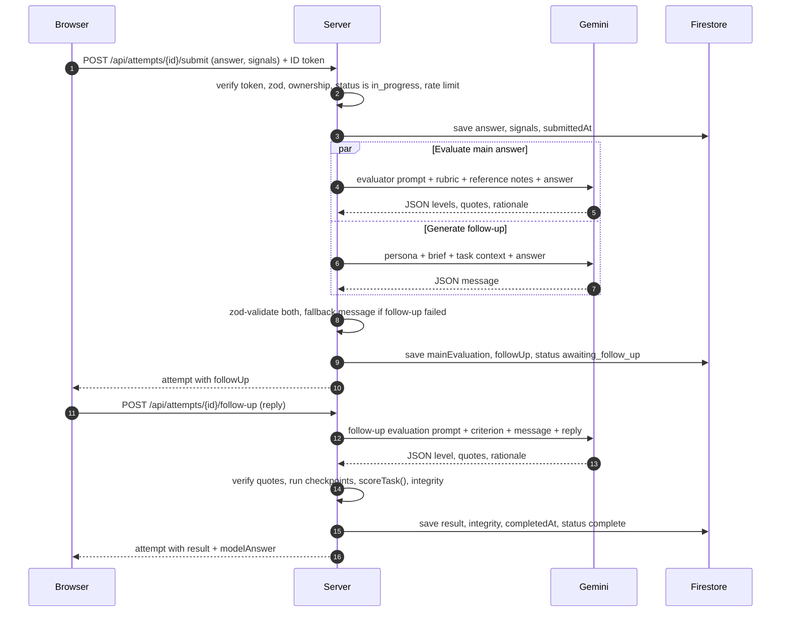
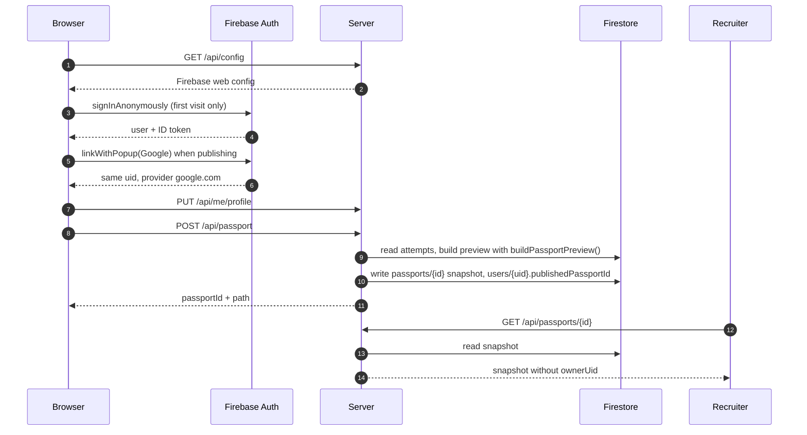

# 04 — Data flow and contracts

The seams between the browser, the server, the model and the database. Write `shared/types.ts` and `shared/schemas.ts` **exactly** as below in Phase 1. Every later phase builds on them.

---

## 1. Domain types — `shared/types.ts`

```ts
export type PillarId = 'technical' | 'problemSolving' | 'edgeCases' | 'communication';
export type Level = 0 | 1 | 2 | 3 | 4;
export type Band = 'strong' | 'proficient' | 'developing' | 'not_yet';
export type TaskDifficulty = 'Beginner' | 'Beginner-Intermediate' | 'Intermediate' | 'Advanced';
export type TaskCategory =
  | 'Systems & Core Programming'
  | 'Data & Observability'
  | 'Workplace Communication & Triage';

export interface RubricCriterion {
  id: string;                 // e.g. 'technical-accuracy'; unique within a task
  criterion: string;          // label shown to the student
  description: string;        // what earns full marks
  pillar: PillarId;
}

export interface Stakeholder {
  name: string;               // 'Sarah Jenkins'
  role: string;               // 'VP of E-Commerce, Nordic Apparel'
}

/** Everything the browser may know about a task. No answers, no checkpoints. */
export interface PublicTask {
  id: string;                 // 'debug-c-program'
  version: number;            // bump when content or rubric changes
  code: string;               // 'TASK-C01'
  title: string;
  subtitle: string;
  difficulty: TaskDifficulty;
  category: TaskCategory;
  estimatedMinutes: number;
  objective: string;
  context: string;
  scenarioDetail: string;
  codeSnippet?: { filename: string; language: 'c'; code: string };
  dataSnippet?: { headers: string[]; rows: (string | number)[][] };
  clientMessage?: { from: string; role: string; subject: string; timestamp: string; body: string };
  instructions: string[];
  rubric: RubricCriterion[];
  hints: string[];            // the existing "Senior Engineer Guidance" content
  answerOutline: string;      // what "Insert answer outline" inserts
  stakeholder: Stakeholder;   // who sends the follow-up
}

export interface CriterionJudgement {
  criterionId: string;
  level: Level;
  evidence: string[];         // quotes the model claims are in the answer (max 3)
  rationale: string;          // one sentence
}

export interface ModelEvaluation {
  criteria: CriterionJudgement[];
  strengths: string[];        // max 3
  improvements: string[];     // max 3
  summary: string;            // max 2 sentences
}

export interface VerifiedCriterion {
  criterionId: string;
  criterion: string;
  pillar: PillarId;
  source: 'answer' | 'followUp';
  modelLevel: Level;          // what the model said
  level: Level;               // after the evidence cap
  verifiedEvidence: string[]; // quotes found in the text
  rejectedEvidence: number;   // count of quotes not found
  capped: boolean;
  rationale: string;
}

export interface CheckpointResult {
  id: string;
  label: string;              // student-facing, e.g. 'Spotted the sizeof(char) allocation bug'
  pillar: PillarId;
  hit: boolean;
}

export interface PillarScore { pillar: PillarId; score: number; band: Band }

export interface TaskResult {
  overall: number;            // 0-100, integer
  band: Band;
  pillars: PillarScore[];     // only pillars this task assesses
  criteria: VerifiedCriterion[];
  checkpoints: CheckpointResult[];
  strengths: string[];
  improvements: string[];
  summary: string;
}

export interface IntegritySignals {
  durationSec: number;        // server-computed
  pastedChars: number;        // browser-reported
  typedChars: number;         // browser-reported
  hiddenCount: number;        // times the tab was hidden, browser-reported
  injectionSuspected: boolean;
}

export interface FollowUp {
  from: string;
  role: string;
  message: string;
  generatedBy: 'model' | 'fallback';
}

export type AttemptStatus = 'in_progress' | 'awaiting_follow_up' | 'complete';

export interface Attempt {
  id: string;
  uid: string;
  taskId: string;
  taskVersion: number;
  status: AttemptStatus;
  startedAt: string;          // ISO, server clock
  submittedAt?: string;
  completedAt?: string;
  answer?: string;
  clientSignals?: { pastedChars: number; typedChars: number; hiddenCount: number };
  mainEvaluation?: ModelEvaluation;
  followUp?: FollowUp;
  followUpAnswer?: string;
  followUpJudgement?: CriterionJudgement;
  result?: TaskResult;
  integrity?: IntegritySignals;
  model: string;              // model ID used, for audit
}

/** What the browser receives about an attempt (no uid). */
export type AttemptView = Omit<Attempt, 'uid' | 'mainEvaluation' | 'followUpJudgement'> & {
  modelAnswer?: string;       // only when status === 'complete'
};

export interface Profile {
  displayName: string;
  college: string;
  degree: string;
  gradYear: number;
}

export interface PassportTaskEntry {
  taskId: string;
  code: string;
  title: string;
  overall: number;
  band: Band;
  pillars: PillarScore[];
  completedAt: string;
  attemptsCount: number;      // completed attempts for this task
  answer: string;
  followUp: { from: string; role: string; message: string; answer: string };
  summary: string;
  strengths: string[];
  criteria: VerifiedCriterion[];
  integrity: IntegritySignals;
}

export interface PassportPreview {
  overall: number | null;     // null when no task is complete
  band: Band | null;
  pillars: PillarScore[];     // pillars with at least one completed task
  tasks: PassportTaskEntry[];
  coverage: { completed: number; total: number };
}

export interface PassportSnapshot extends PassportPreview {
  passportId: string;
  displayName: string;
  college: string;
  degree: string;
  gradYear: number;
  identityVerified: boolean;  // true when signed in with Google at publish time
  track: 'Junior Software Developer';
  issuedAt: string;
  updatedAt: string;
}
```

---

## 2. Validation schemas — `shared/schemas.ts`

All zod v4. Every object is `.strict()` (unknown keys rejected).

```ts
export const TaskIdParam = z.object({ taskId: z.string().regex(/^[a-z0-9-]{3,40}$/) }).strict();
export const AttemptIdParam = z.object({ attemptId: z.string().regex(/^[A-Za-z0-9]{20}$/) }).strict();
export const PassportIdParam = z.object({ passportId: z.string().regex(/^[a-z2-7]{12}$/) }).strict();

export const StartAttemptBody = z.object({ taskId: z.string().regex(/^[a-z0-9-]{3,40}$/) }).strict();

export const SubmitBody = z.object({
  answer: z.string().trim().min(40).max(12_000),
  signals: z.object({
    pastedChars: z.number().int().min(0).max(1_000_000),
    typedChars: z.number().int().min(0).max(1_000_000),
    hiddenCount: z.number().int().min(0).max(10_000),
  }).strict(),
}).strict();

export const FollowUpBody = z.object({ answer: z.string().trim().min(10).max(4_000) }).strict();

export const ProfileBody = z.object({
  displayName: z.string().trim().min(2).max(60),
  college: z.string().trim().min(2).max(120),
  degree: z.string().trim().min(2).max(80),
  gradYear: z.number().int().min(2000).max(2035),
}).strict();

/** Model output for the main evaluation. criterionId enum is built per task. */
export function modelEvaluationSchema(criterionIds: [string, ...string[]]) {
  return z.object({
    criteria: z.array(z.object({
      criterionId: z.enum(criterionIds),
      level: z.number().int().min(0).max(4),
      evidence: z.array(z.string().max(400)).max(3),
      rationale: z.string().max(300),
    })).length(criterionIds.length),
    strengths: z.array(z.string().max(200)).max(3),
    improvements: z.array(z.string().max(200)).max(3),
    summary: z.string().max(400),
  });
}

export const FollowUpMessageSchema = z.object({ message: z.string().min(20).max(700) });

export const FollowUpJudgementSchema = z.object({
  level: z.number().int().min(0).max(4),
  evidence: z.array(z.string().max(400)).max(3),
  rationale: z.string().max(300),
});
```

After parsing `modelEvaluationSchema`, the evaluator also checks that every criterion ID appears **exactly once** (zod's `length` does not catch duplicates). A duplicate or missing ID counts as invalid output (retry once).

---

## 3. HTTP API

Base path `/api`. JSON in and out. Authenticated routes need `Authorization: Bearer <Firebase ID token>`. Errors are always `{ "error": "<code>" }`.

| Method & path | Auth | Rate limit | Request | Success response |
|---|---|---|---|---|
| `GET /healthz` | – | – | – | `200 { ok: true }` |
| `GET /api/config` | – | global | – | `200 { firebase: { apiKey, authDomain, projectId, appId } }` |
| `GET /api/tasks` | – | global | – | `200 { tasks: PublicTask[] }` (also bundled; this route exists for the API contract and tests) |
| `GET /api/me` | yes | global | – | `200 { profile: Profile \| null, identityVerified: boolean, attempts: AttemptView[], passport: PassportPreview, published: { passportId: string } \| null }` |
| `PUT /api/me/profile` | yes | global | `ProfileBody` | `200 { profile }` |
| `POST /api/attempts` | yes | global | `StartAttemptBody` | `201 { attempt: AttemptView }`; reuses an open attempt for the same task (returns `200`) |
| `GET /api/attempts/:attemptId` | yes | global | – | `200 { attempt: AttemptView }` |
| `POST /api/attempts/:attemptId/submit` | yes | eval: 10 / 10 min / uid | `SubmitBody` | `200 { attempt: AttemptView }` with `status: 'awaiting_follow_up'` and `followUp` set |
| `POST /api/attempts/:attemptId/follow-up` | yes | eval: 10 / 10 min / uid | `FollowUpBody` | `200 { attempt: AttemptView }` with `status: 'complete'`, `result`, `integrity`, `modelAnswer` |
| `POST /api/passport` | yes | global | – | `200 { passportId, path }` where `path` is `/p/<passportId>`; the browser builds the full link from `location.origin` |
| `DELETE /api/passport` | yes | global | – | `204` |
| `GET /api/passports/:passportId` | – | 60 / min / IP | – | `200 { passport: PassportSnapshot }` |

### Error codes

| HTTP | `error` | When |
|---|---|---|
| 400 | `invalid_request` | zod failed on params, query or body |
| 401 | `unauthenticated` | Missing, malformed, expired or invalid ID token |
| 404 | `not_found` | Unknown route, unknown task, attempt not owned by the caller, passport missing |
| 409 | `invalid_state` | Submit when not `in_progress`; follow-up when not `awaiting_follow_up` |
| 409 | `profile_required` | Publish without a profile |
| 409 | `nothing_to_publish` | Publish with no completed attempt |
| 413 | `payload_too_large` | Body over 32 kB |
| 429 | `rate_limited` | Any rate limit |
| 503 | `evaluation_unavailable` | Model failed twice; the answer is saved and the attempt state is unchanged |
| 500 | `internal` | Anything else (details in logs only) |

### State machine of an attempt



---

## 4. Firestore data model

All access goes through the server (Admin SDK). `firestore.rules` denies all client access.

```
users/{uid}
  profile: Profile | null
  publishedPassportId: string | null
  createdAt: string, updatedAt: string

attempts/{attemptId}                 // attemptId = Firestore auto-ID (20 chars)
  ...Attempt (see §1), including uid

passports/{passportId}               // passportId = 12 chars, base32 lowercase a-z2-7
  ...PassportSnapshot
  ownerUid: string                   // stored for unpublish; never returned by the API
```

Queries needed:
- Attempts of a user: `where('uid', '==', uid)`. A single-field index, created automatically. Sort in memory by `startedAt` (a student has at most a few dozen).
- Open attempt for a task: filter the same list in memory (`status !== 'complete' && taskId === X`). This avoids a composite index, so there is nothing to create in the console.

What is stored, and why: answers (needed for the passport and re-evaluation), model judgements (audit trail behind every score), browser integrity counts, profile fields the student typed. No email address. No ID tokens. No IP addresses.

---

## 5. Sequence: submit and follow-up



## 6. Sequence: sign-in, publish, recruiter view



---

## 7. Front-end data flow

- `useAuth()` initialises Firebase from `/api/config` once, signs in anonymously if there is no user, and exposes `{ user, isAnonymous, signInWithGoogle, signOut, getIdToken }`.
- `api.ts` wraps `fetch`: adds the ID token, parses JSON, and throws `ApiError(status, code)` on non-2xx. One function per route (`getMe`, `startAttempt`, `submitAttempt`, `sendFollowUp`, `saveProfile`, `publishPassport`, `unpublishPassport`, `getPublicPassport`).
- `useMe()` loads `/api/me` and exposes `{ data, loading, error, refresh }`. Dashboard, Tasks, Navbar and Passport read from it. After any attempt completes or the profile changes, call `refresh()`.
- `useIntegrity(textareaRef)` counts pasted characters (`paste` event, `clipboardData.getData('text').length`), typed characters (`beforeinput` with `inputType === 'insertText'`, adding `data.length`), and `visibilitychange` to hidden. Values are sent with submit.
- Drafts: `localStorage['btr:draft:<attemptId>']`, wrapped in try/catch. Cleared on successful submit.
- Public task content is imported from `@/shared/tasks`; no fetch is needed to show a brief.
